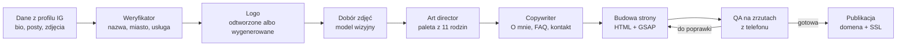

# Generator animowanych stron www z profilu Instagram (Agentic AI)

**Jedna komenda: nick salonu beauty z Instagrama → gotowa, animowana strona firmy.**
Python · agenci LLM (Claude, GPT, Gemini) · modele wizyjne · Playwright · OpenCV · GSAP + ScrollTrigger + Lenis

Generator jest częścią mojego systemu sprzedaży stron dla branży beauty. Gdy salon odpisał na pierwszą wiadomość, generator od razu budował **gotową stronę jego firmy** z profilu Instagram, a kolejną wiadomością była oferta z linkiem do tej strony, zanim salon cokolwiek zapłacił. Klient od razu widział efekt, więc to właśnie strona najmocniej przekonywała do zakupu. Cały lejek dał **ok. 30 klientów w 2 miesiące**.

## Przykłady na żywo

| Wersja | Strona |
|---|---|
| Aktualna: „Moment w lustrze” (puderniczka otwiera się na scrollu, w lusterku zdjęcie z profilu) | [examplewebsite.pl/zaczarowanerzesypoznan](https://examplewebsite.pl/zaczarowanerzesypoznan/) |
| Wcześniejszy szablon (układ magazynowy) | [examplewebsite.pl/agath_concept](https://examplewebsite.pl/agath_concept/) |

Najlepiej oglądać na telefonie, bo tam klientki otwierały link z wiadomości.

## Jak to działa



1. **Weryfikator** ustala nazwę firmy (z polskimi znakami), miasto, formę „ja / my” i typ usługi (rzęsy, brwi, PMU, paznokcie, twarz).
2. **Logo** jest odtwarzane z awatara albo okładek, a gdy go nie ma, generowane ([`generator_logo.py`](generator_logo.py)).
3. **Dobór zdjęć**: model wizyjny ocenia zdjęcia z profilu na arkuszach miniatur i wybiera najlepsze kadry do hero, galerii i lusterka ([`dobierz_zdjecie.py`](dobierz_zdjecie.py)).
4. **Art director** wybiera jedną z 11 rodzin kolorystycznych na podstawie okładek i postów ([`paleta_beauty.py`](paleta_beauty.py)).
5. **Copywriter** pisze sekcję O mnie, tekst przy kontakcie, stopkę i poprawia pytania FAQ.
6. **Budowa**: warstwy puderniczki z kolorem wieczka pod klientkę ([`puderniczka.py`](puderniczka.py)), hero i cała strona z szablonu ([`szablon/`](szablon/), [`zbuduj_strone.py`](zbuduj_strone.py)).
7. **QA**: Playwright robi zrzuty strony w widoku telefonu, agent ocenia je i zwraca „gotowa” albo listę problemów, które są sprawdzane drugi raz.

Całość uruchamia [`generuj.py`](generuj.py), a agentów obsługuje [`agenci.py`](agenci.py).

**Dwa tryby pracy:** generator działa automatycznie wewnątrz [systemu sprzedaży na Instagramie](https://github.com/patrykolech/instagram-ai-outreach) (strona powstaje, gdy salon odpisze na pierwszą wiadomość) albo samodzielnie, z panelu: wpisuje się nick salonu i dostaje gotową stronę, np. na potrzeby rozmowy z klientem spoza kampanii.

## Najważniejsze decyzje

- **Agent nie może dopisać faktu spoza danych.** Każdą odpowiedź modelu sprawdza kod: nazwa, miasto czy usługa przechodzą tylko wtedy, gdy potwierdzają je dane z profilu. Dzięki temu strona nie wymyśla adresu ani usług, których salon nie robi.
- **Modele zapasowe.** Każda rola ma łańcuch modeli (np. Claude Sonnet, a w razie błędu GPT). Brak środków czy awaria jednego dostawcy nie zatrzymuje generatora.
- **Pamięć odpowiedzi.** Wyniki agentów są zapisywane, więc drugie uruchomienie dla tej samej klientki prawie nic nie kosztuje.
- **Koszt AI poniżej 1 zł za stronę**, liczony na bieżąco z liczników zużycia API.
- **Generator, a nie ręczne składanie.** Szablon działa dla całej branży beauty (rzęsy, brwi, PMU, paznokcie, makijaż), a sceny i zdjęcia zmieniają się pod typ usługi.

## Animacje i wydajność

- GSAP + ScrollTrigger + SplitText + Lenis ([`assets/js/`](assets/js/)): puderniczka otwiera się na scrollu i lusterko rośnie do pełnego zdjęcia.
- Strona działa też bez JavaScriptu, a animacje szanują `prefers-reduced-motion`.
- Poprawka pod przeglądarkę wbudowaną w Instagram (zmieniająca się wysokość ekranu przy chowaniu pasków).
- Testy w [`testy/`](testy/): płynność animacji klatka po klatce, dostępność, układ, LCP, wersja bez JS.

## Struktura

```
generuj.py            cały proces jedną komendą
agenci.py             weryfikator, art director, copywriter, QA (zapytania API z kontrolą odpowiedzi)
dobierz_zdjecie.py    dobór zdjęć modelem wizyjnym
generator_logo.py     odtworzenie albo wygenerowanie logo
puderniczka.py        warstwy grafiki hero pod klientkę
zbuduj_hero.py        hero strony
zbuduj_strone.py      cała strona z szablonu
szablon/              HTML sekcji (usługi, galeria, opinie, FAQ, kontakt...)
assets/               CSS, JS, fonty (OFL)
baza/, obrazy/        wspólne warstwy puderniczki (grafiki wygenerowane AI)
testy/                testy animacji, dostępności i wydajności
```

## Uruchomienie

```bash
pip install pillow numpy scipy opencv-python-headless playwright
playwright install chromium

export BYTECATCODE_CLAUDE_KEY=...    # klucze do bramek API z modelami
export BYTECATCODE_OPENAI_KEY=...
export BSF_DATA=/sciezka/do/danych   # dane profili: <nick>/profile.json + zdjęcia

python generuj.py <nick>
```

Dane profili pochodzą z mojego scrapera Instagrama i nie są częścią repozytorium.

## Uwagi

- Repozytorium nie zawiera zdjęć, logo ani danych klientek. Nazwy w przykładach są zmienione.
- Fonty na licencji SIL OFL, biblioteki GSAP i Lenis zgodnie z ich licencjami.
- Kod powstał z pomocą asystentów AI (Claude Code). Architektura, zasady pracy agentów, kontrola jakości i testy na prawdziwych klientkach są moje.

---

**Autor:** Patryk Olech, AI Automation & GTM Engineer · [inne projekty](https://github.com/patrykolech)
