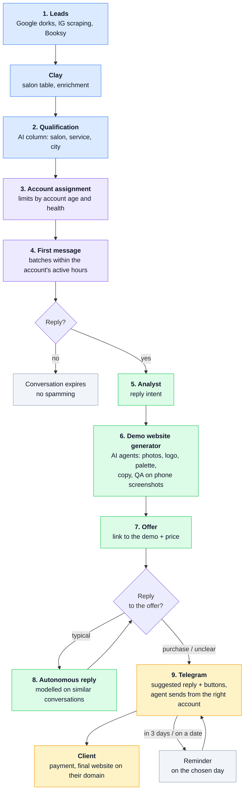

# Instagram AI: autonomous sales system for beauty-industry websites

**Commercial project. The core system is private; this page describes its architecture, orchestration and results. The website generator code is public in [`/generator`](generator/).**

Python · asyncio · Playwright · browser-use · MCP · multi-agent system · LLMs (Claude, GPT, Gemini) · vision models · SQLite (WAL) · Clay · Telegram Bot API · GSAP · VPS

One system runs the whole sales process: it finds beauty salons on Instagram, messages them from multiple accounts, reads the replies, **generates an animated demo website for every salon that replies** and sends an offer with a link to it. Typical replies are handled autonomously; I step into a conversation with one tap in Telegram when a client is close to buying.

## Results

| | |
|---|---|
| First messages sent | **5,142** |
| Replies | **2,671 (52%)** |
| Offers sent with a demo website | **~2,600** |
| Salons that bought a website | **~30 in 2 months**, no salesperson |
| Instagram accounts running in parallel | **up to 15** |
| AI cost of one demo website | **~0.10-0.15 PLN** (depending on the template and the models assigned to the agents) |

## How it works



Colours: blue is data, purple is accounts and sending, green is AI agents, yellow is sales with a human in the loop.

### 1. Lead sourcing

- **Google dorks** (e.g. `site:instagram.com "lashes" "Krakow"`) return business profiles that Instagram's own search does not surface.
- **Scraping Instagram profiles** by city and district, and **salons from Booksy**: handle, name, bio, follower count, link in bio, category.
- **Qualification** happens in Clay (see below): rejected profiles never reach the sending queue.
- **Deduplication across accounts and sources**, so no salon gets messaged twice from different accounts.

### Clay: the salon table

Leads from all sources land in a single Clay table (imported via webhook):

- **Enrichment**: whether the salon already has a website, whether it is on Booksy, phone number and address from the Google Business profile, city and district.
- **An AI column** reads the bio and name to decide whether it is a business rather than a private account, and which service it offers (lashes, brows, PMU, nails, skincare). Salons without a website get a higher priority, because the offer fits them best.
- **Deduplication by handle**, so a salon found in several sources is one row.
- **Statuses flow back to Clay via webhook** on every stage change: first message, reply, link to the generated demo, offer and price, reply to the offer, client. The funnel per city, service and account is visible in one place.

### 2. Account management

- Every account has **its own antidetect browser profile**, **a static mobile proxy** and its own MCP server through which the agents control the browser. Some accounts also ran on Android emulators.
- **Limits based on account age and health**: a new account starts with a small number of first messages per day (~20-25) and only proven accounts go up to ~50-55. On top of that there is an hourly cap, a minimum gap between offers and no offers in the first hour of an account's activity.
- **New accounts send offers only to people who received the first message on a previous day**, so they do not produce a burst of links right after starting.
- **A daily plan for each account**: no activity at night, one longer and several short breaks with random offsets, messages sent in batches of 3-5 spread over the day. The browser is closed during breaks.
- **Health monitoring**: "Failed to send", action blocks, verification requests (selfie), logouts or suspensions automatically pause the account, send **a Telegram alert** and move its lead queue to the remaining accounts.
- **The system knows how many healthy accounts it has and how many messages it can send today**, distributes leads accordingly and reports when the lead pool is running out.

### 3. First message

- A short, conversational message (e.g. asking whether the salon takes new clients), in several variants and with a tone matching the account (female and male accounts).
- Sent in batches within the account's active hours, with a check that the message actually went through (visible in the thread).

### 4. Inbox and reply analysis

- **The inbox agent** reviews conversations regularly (a quick glance every few minutes, a full scan every few hours).
- **Code first, model only as a fallback**: reading a thread is done by code (selectors, an anchor on the last saved message); a browser agent with an LLM steps in only when the code finds nothing. Before saving, the code verifies that the right conversation is open.
- **The analyst** classifies the reply: interest, question about a date, question about the price, refusal, fully booked, Instagram system message. System messages close the lead without a website or an offer.

### 5. Website generator

- **Everyone who replies to the first message** triggers a **demo website** build: a sample animated website made from the salon's own photos, name and services. It is not the final product, but a showcase of what I can build for the salon before they pay. Once the demo is ready, the next message is an offer with a link to it.
- The final website is built after the purchase, in a style agreed with the client, on their own domain.
- Generator agents: data verifier (name, city, service), photo selection with a vision model, logo recreation or generation, art director (palette from 11 families), copywriter, QA on phone screenshots. The demo is published on a domain with SSL.
- The generator also works on its own, from a dashboard. Its code is in [`generator/`](generator/); live example: [examplewebsite.pl/zaczarowanerzesypoznan](https://examplewebsite.pl/zaczarowanerzesypoznan/).

### 6. Offer

- A sequence of a few short messages: a hook, the link to the demo with a note that it is an example of what I can build, the price of the final website, a closing question.
- **Price based on profile size** (tiers by follower count).
- **A/B tests**: opening line, prices, variant with and without a screenshot of the website, split into groups from a fixed date.

### 7. Replies to the offer: autonomy with a human in the loop

- Every reply gets a **LOW / MEDIUM / HIGH score** and a summary of what the client wants.
- **Conversation memory**: the system retrieves similar past conversations (mainly the ones where I replied myself) and drafts a reply in my style based on them (few-shot from history).
- **Typical situations are handled by the bot**: how the website works, delivery time, a request for a different style, "I'll get back to you later".
- **Purchases, negotiations and unclear replies come to me** in Telegram with a ready draft: I send it with one tap or write my own with the command "reply @handle ...".
- **I reply only from Telegram, without logging in to any Instagram account.** After tapping "Send" or using the "reply @handle ..." command, the task goes to the agent of the account that owns the conversation: the agent opens that account's browser profile, finds the conversation with the client, checks that the right thread is open, sends the message and confirms in Telegram. With a dozen accounts, one person runs all sales from a phone.
- **Reminders**: a "not now" lead is snoozed until the date mentioned in the conversation, and on that day I get a reminder with context. Conversations without a reply expire quietly, without follow-up spam.

### 8. Orchestration

- **The orchestrator** runs the agents as separate processes: scout (queue and sending), analyst, executor (website build and offer), inbox agent, conversation keeper. It prevents duplicate instances (MCP ports) and brings the agents back up after a server restart.
- **Asynchronous event bus** on SQLite in WAL mode: agents never call each other directly, they publish tasks on topics (e.g. `lead.messages`, `site.build`, `offer.send`). Every task has a state, an attempt counter, retries with backoff and can be postponed.
- **Resilience to AI providers**: model chains with fallbacks at other providers. Running out of credits (HTTP 402) does not burn attempts; the task is postponed, website builds pause, and the system resumes on its own after a top-up.
- **Live settings**: limits, sending windows, offer approval mode, account breaks and test variants are flags in the database, changed from Telegram without a restart.
- **Data safety**: database and config backups before every major change, unit tests for the agents, deployment to the server via git.

### 9. Telegram as the control centre

Real examples (translated from Polish, handles changed).

**Daily summary** (19 Nov 2026):

```
hour   1st msg  offers  replies
08:00       2      11       2
12:00       5       3       3
16:00      13       7       6
19:00      10       6      18
21:00       9       8      11
...
total      98      72      99

First messages: 98 (previous day 87), account limits: 4/0 · 50/50 · 44/50
Offers sent: 72 (previous day 57) · queued: 18
Replied to the first message: 74 (69 → demo website, 5 other), ~75% of today's sends
Replied after the offer: 25 (10 no, 10 neutral, 3 interested, 2 very interested, 2 want to buy)
```

**A reply to an offer with a score and a suggested answer:**

```
🔥 @example_salon replied to the offer - HIGH
"Great! I'll sort it out calmly and get back to you! I'm planning to launch training courses..."

🧠 Very interested, especially in the context of the planned courses
💤 Snoozed until 04.12.2026 (wants to take her time) - I'll remind you then

✍️ Suggested reply:
   "Great, I'm glad! Once you've sorted everything out, just message me,
    I'll happily add a section for your courses"
📚 Modelled on 6 similar conversations (5 written by you)

[ Send this reply ] [ No ] [ In 3 days ] [ Client ] [ Close ]
```

**Alerts**: account block or suspension, logout, out of credits at an AI provider, website build error (with "retry" and "skip" buttons), lead pool running out.

## Specification

| Layer | Solution |
|---|---|
| Browser control | Playwright, browser-use, one MCP server per account, antidetect browser, mobile proxies |
| Agents | orchestrator + 5 roles, asynchronous event bus (SQLite WAL) |
| Models | Claude (Sonnet, Haiku), GPT, Gemini through API gateways with fallback chains; vision models for photos and screenshots |
| Website generator | Python, HTML templates, GSAP + ScrollTrigger + Lenis, QA in Playwright |
| Lead data | Clay: salon table, enrichment, AI columns, funnel statuses via webhook |
| Operational data | SQLite (conversations, tasks, agent flags) |
| Control and alerts | Telegram Bot API: summaries, decision buttons, alerts, settings changes |
| Infrastructure | Windows Server on a VPS, SSH, git, backups |

## Roadmap

Things that do not exist yet and are the next step:

- **Long-term agent memory.** Each conversation's state as a graph (LangGraph with a checkpointer) instead of individual tasks, plus a vector store of conversations (e.g. pgvector) to retrieve similar cases instead of keyword matching.
- **Evaluations and prompt versioning.** A test set of real replies with scores (e.g. LangSmith or custom evals), so every prompt or model change is measured before deployment.
- **Account health score.** A single number per account computed from block history, reply rate and account age, which sets daily limits automatically.
- **Learning from my own replies.** Fine-tuning a small model on the replies I sent manually, so more conversations run without me.
- **Metrics dashboard.** The funnel per account, per message variant and per city in one dashboard instead of Telegram summaries.

## My role

I designed and built the whole system myself: the funnel, the agent architecture, account management, the website generator, server deployment and day-to-day sales operations.

---

**Author:** Patryk Olech, AI Automation & GTM Engineer · [more projects](https://github.com/patrykolech)
