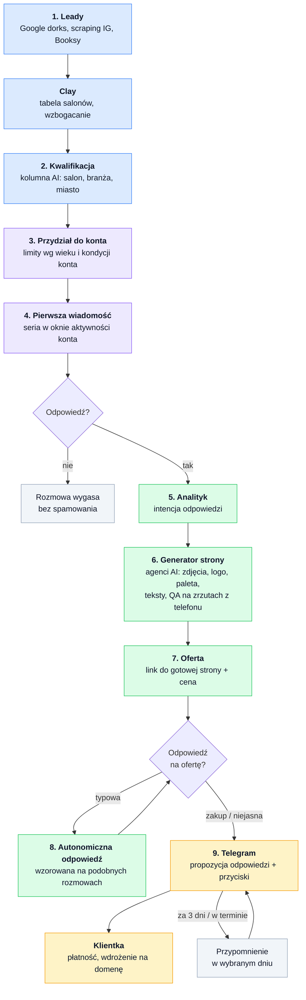

# Instagram AI: autonomiczny system sprzedaży stron www dla branży beauty

**Projekt komercyjny. Kod jest prywatny, tutaj opisuję architekturę, orkiestrację i wyniki.**
Python · asyncio · Playwright · browser-use · MCP · system wieloagentowy · LLM (Claude, GPT, Gemini) · modele vision · SQLite (WAL) · Clay · Telegram Bot API · GSAP · VPS

Jeden system robi całą sprzedaż: znajduje salony beauty na Instagramie, pisze do nich z wielu kont, czyta odpowiedzi, **dla każdego, kto odpisze, generuje animowaną stronę jego salonu** i wysyła ofertę z linkiem do tej strony. Typowe odpowiedzi obsługuje sam, a ja wchodzę do rozmowy jednym przyciskiem w Telegramie, gdy klient jest blisko zakupu.

## Wynik

| | |
|---|---|
| Wysłane pierwsze wiadomości | **5 142** |
| Odpowiedzi | **2 671 (52%)** |
| Wysłane oferty z gotową stroną | **ok. 2 600** |
| Klienci | **ok. 30 w 2 miesiące**, bez handlowca |
| Konta Instagram pracujące równolegle | **do 15** |
| Koszt AI jednej strony | **poniżej 1 zł** |

## Jak działa całość



Kolory: niebieski to dane, fioletowy to konta i wysyłka, zielony to agenci AI, żółty to sprzedaż z udziałem człowieka.

### 1. Pozyskiwanie leadów

- **Google dorks** (np. `site:instagram.com "rzęsy" "Kraków"`) zwracają profile firm, których nie widać w wyszukiwarce Instagrama.
- **Scraping profili Instagram** po miastach i dzielnicach oraz **salonów z Booksy**: nick, nazwa, bio, liczba obserwujących, link w bio, kategoria.
- **Kwalifikacja** odbywa się w Clay (opis niżej): odrzucone profile nie trafiają do kolejki wysyłki.
- **Deduplikacja między kontami i źródłami**, żeby żaden salon nie dostał wiadomości dwa razy z różnych kont.

### Clay: tabela salonów

Leady ze wszystkich źródeł trafiają do jednej tabeli w Clay (import przez webhook):

- **Wzbogacanie**: czy salon ma już stronę www, czy jest na Booksy, telefon i adres z wizytówki Google, miasto i dzielnica.
- **Kolumna AI** rozpoznaje z bio i nazwy, czy to działalność, a nie konto prywatne, i jaka usługa (rzęsy, brwi, PMU, paznokcie, twarz). Salony bez strony dostają wyższy priorytet, bo dla nich oferta jest najbardziej trafiona.
- **Deduplikacja po nicku** w tabeli, żeby salon z kilku źródeł był jednym wierszem.
- **Statusy z systemu wracają do Clay webhookiem** przy każdej zmianie etapu: pierwsza wiadomość, odpowiedź, link do wygenerowanej strony, oferta i cena, odpowiedź po ofercie, klientka. Lejek per miasto, branża i konto widać w jednym miejscu.

### 2. Zarządzanie kontami

- Każde konto ma **własny profil w przeglądarce antidetect**, **stałe proxy mobilne** i własny serwer MCP, przez który agenci sterują przeglądarką. Część kont działała też na emulatorach Androida.
- **Limity zależne od wieku i kondycji konta**: nowe konto zaczyna od małej liczby pierwszych wiadomości dziennie (ok. 20-25), a dopiero sprawdzone konta dochodzą do ok. 50-55. Do tego limit na godzinę, minimalny odstęp między ofertami i brak ofert w pierwszej godzinie aktywności konta.
- **Nowe konta wysyłają oferty dopiero do osób, które dostały pierwszą wiadomość poprzedniego dnia**, żeby nie generować serii linków zaraz po starcie.
- **Plan dnia dla każdego konta**: noc bez aktywności, jedna dłuższa i kilka krótkich przerw z losowym przesunięciem, wysyłka seriami 3-5 wiadomości rozłożona na cały dzień. Przeglądarka w przerwie jest zamknięta.
- **Monitoring kondycji**: „Failed to send”, blokada akcji, wymóg weryfikacji (selfie), wylogowanie albo zawieszenie konta automatycznie wstrzymują to konto, wysyłają **alert na Telegram** i przenoszą jego kolejkę leadów na pozostałe konta.
- **System wie, ile ma sprawnych kont i ile wiadomości może dziś wysłać**, i według tego rozkłada leady oraz raportuje, kiedy kończy się pula.

### 3. Pierwsza wiadomość

- Krótka wiadomość w stylu zwykłej rozmowy (np. pytanie, czy salon przyjmuje nowe klientki), w kilku wariantach i z różnym tonem zależnie od konta (konta kobiece i męskie).
- Wysyłka seriami w oknie aktywności konta, z kontrolą, że wiadomość faktycznie poszła (widoczna w wątku).

### 4. Skrzynka i analiza odpowiedzi

- **Agent skrzynki** regularnie przegląda rozmowy (szybki rzut oka co kilka minut, pełny skan co kilka godzin).
- **Najpierw kod, model tylko awaryjnie**: odczyt wątku robi kod (selektory, kotwica ostatniej zapisanej wiadomości), a agent przeglądarkowy z LLM wchodzi dopiero wtedy, gdy kod nic nie znajdzie. Przed zapisem kod sprawdza, czy otwarta jest właściwa rozmowa.
- **Analityk** klasyfikuje odpowiedź: zainteresowanie, pytanie o termin, pytanie o cenę, odmowa, brak miejsc, komunikat systemowy Instagrama. Komunikaty systemowe kończą lead bez strony i oferty.

### 5. Generator strony

- **Każdy, kto odpisze na pierwszą wiadomość**, uruchamia budowę strony. Gdy strona jest gotowa, kolejną wiadomością jest oferta z linkiem do niej.
- Agenci generatora: weryfikator danych (nazwa, miasto, usługa), dobór zdjęć modelem vision, odtworzenie albo wygenerowanie logo, art director (paleta z 11 rodzin), copywriter, QA na zrzutach z telefonu. Strona jest publikowana na domenie z SSL.
- Generator działa też samodzielnie, z panelu: [beauty-site-generator](https://github.com/patrykolech/beauty-site-generator), przykład: [examplewebsite.pl/zaczarowanerzesypoznan](https://examplewebsite.pl/zaczarowanerzesypoznan/).

### 6. Oferta

- Sekwencja kilku krótkich wiadomości: nawiązanie, link do gotowej strony, cena, pytanie zamykające.
- **Cena zależna od wielkości profilu** (progi według liczby obserwujących).
- **Testy A/B**: treść otwarcia, ceny, wariant ze zrzutem strony i bez, z podziałem na grupy od ustalonej daty.

### 7. Odpowiedzi po ofercie: autonomia i człowiek w pętli

- Każda odpowiedź dostaje **ocenę LOW / MEDIUM / HIGH** i streszczenie, czego klientka chce.
- **Pamięć rozmów**: system wyszukuje podobne wcześniejsze rozmowy (przede wszystkim te, w których odpisywałem sam) i na ich wzór przygotowuje odpowiedź w moim stylu (few-shot z historii).
- **Typowe sytuacje bot obsługuje sam**: pytania o to, jak działa strona, o termin realizacji, prośba o inny styl, „odezwę się później”.
- **Zakup, negocjacje i niejasne odpowiedzi idą do mnie** na Telegram z gotową propozycją: wysyłam ją jednym przyciskiem albo piszę własną komendą „odpisz @nick …”.
- **Przypomnienia**: lead „nie teraz” jest odkładany do daty wyczytanej z rozmowy, a w tym dniu dostaję przypomnienie z kontekstem. Rozmowy bez odpowiedzi wygasają po cichu, bez dopisywania kolejnych wiadomości.

### 8. Orkiestracja

- **Orkiestrator** uruchamia agentów jako osobne procesy: zwiadowca (kolejka i wysyłka), analityk, wykonawca (budowa strony i oferta), agent skrzynki, opiekun rozmów. Pilnuje, żeby nie uruchomić dwóch kopii (porty MCP), i podnosi agentów po restarcie serwera.
- **Asynchroniczna szyna zdarzeń** na SQLite w trybie WAL: agenci nie wołają się bezpośrednio, tylko publikują zadania na tematach (np. `lead.messages`, `site.build`, `offer.send`). Każde zadanie ma stan, licznik prób, ponawianie z odczekaniem i może zostać odroczone.
- **Odporność na dostawców AI**: łańcuchy modeli z zapasem u innych dostawców. Brak środków (HTTP 402) nie zjada prób, tylko odracza zadanie i wstrzymuje budowę stron, a po doładowaniu system sam wraca do pracy.
- **Ustawienia w locie**: limity, okna wysyłki, tryb akceptacji ofert, przerwy kont i warianty testów są flagami w bazie, zmienianymi z Telegrama bez restartu.
- **Bezpieczeństwo danych**: kopie bazy i konfiguracji przed każdą większą zmianą, testy jednostkowe agentów, wdrożenie przez git na serwer.

### 9. Telegram jako centrum sterowania

Przykłady z prawdziwego działania (nicki zmienione).

**Podsumowanie dnia** (19.11.2026):

```
godz   1.wiad  oferty  odp
08:00       2      11    2
12:00       5       3    3
16:00      13       7    6
19:00      10       6   18
21:00       9       8   11
...
razem      98      72   99

1. wiadomości: 98 (dzień wcześniej 87), limity kont: 4/0 · 50/50 · 44/50
Oferty wysłane: 72 (dzień wcześniej 57) · w kolejce: 18
Odpisało na 1. wiadomość: 74 (69 → strona, 5 inne), ok. 75% dzisiejszych wysyłek
Odpisało po ofercie: 25 (10 odmów, 10 neutralnych, 3 zainteresowane, 2 bardzo, 2 chcą kupić)
```

**Odpowiedź na ofertę z oceną i propozycją:**

```
🔥 @salon_przyklad odpisała na ofertę - HIGH
„Świetne! Na spokojnie to ogarnę i się odezwę! Planuję wprowadzić szkolenia..."

🧠 Bardzo zainteresowana, szczególnie w kontekście planowanych szkoleń
💤 Odłożona do 04.12.2026 (chce ogarnąć na spokojnie) - wtedy przypomnę

✍️ Propozycja odpowiedzi:
   „Super, cieszę się! Jak ogarniesz wszystko na spokojnie, to śmiało pisz,
    chętnie dodam sekcję ze szkoleniami"
📚 Wzorowane na 6 podobnych rozmowach (5 pisanych przez Ciebie)

[ Wyślij tę odpowiedź ] [ Nie ] [ Za 3 dni ] [ Klientka ] [ Zamknij ]
```

**Alerty**: blokada albo zawieszenie konta, wylogowanie, brak środków u dostawcy AI, błąd budowy strony (z przyciskami „ponów” i „pomiń”), koniec puli leadów.

## Specyfikacja

| Warstwa | Rozwiązanie |
|---|---|
| Sterowanie przeglądarką | Playwright, browser-use, serwer MCP na konto, przeglądarka antidetect, proxy mobilne |
| Agenci | orkiestrator + 5 ról, asynchroniczna szyna zdarzeń (SQLite WAL) |
| Modele | Claude (Sonnet, Haiku), GPT, Gemini przez bramki API z łańcuchami zapasowymi; modele vision do zdjęć i zrzutów |
| Generator stron | Python, szablony HTML, GSAP + ScrollTrigger + Lenis, QA w Playwright |
| Dane o leadach | Clay: tabela salonów, wzbogacanie, kolumny AI, statusy lejka z webhooka |
| Dane operacyjne | SQLite (rozmowy, zadania, flagi agentów) |
| Sterowanie i alerty | Telegram Bot API: podsumowania, przyciski decyzji, alerty, zmiana ustawień |
| Infrastruktura | Windows Server na VPS, SSH, git, kopie zapasowe |

## Plan rozwoju

Rzeczy, których jeszcze nie ma, a które są następnym krokiem:

- **Pamięć długoterminowa agentów.** Stan każdej rozmowy jako graf (LangGraph z checkpointerem) zamiast pojedynczych zadań, oraz baza wektorowa rozmów (np. pgvector) do wyszukiwania podobnych przypadków zamiast dopasowania po słowach.
- **Ewaluacje i wersjonowanie promptów.** Zestaw testowy prawdziwych odpowiedzi z oceną (np. LangSmith albo własne evale), żeby każda zmiana promptu albo modelu była mierzona przed wdrożeniem.
- **Wynik zdrowia konta.** Jedna liczba dla każdego konta liczona z historii blokad, odsetka odpowiedzi i wieku konta, która sama ustawia dzienne limity.
- **Nauka na własnych odpowiedziach.** Dostrojenie małego modelu na odpowiedziach, które wysłałem ręcznie, żeby więcej rozmów szło bez mojego udziału.
- **Panel metryk.** Lejek per konto, per wariant wiadomości i per miasto w jednym dashboardzie zamiast podsumowań w Telegramie.

## Moja rola

Całość zaprojektowałem i zbudowałem sam, z pomocą asystentów AI (Claude Code): lejek, architekturę agentów, zarządzanie kontami, generator stron, wdrożenie na serwer i codzienną obsługę sprzedaży.

---

**Autor:** Patryk Olech, AI Automation & GTM Engineer · [inne projekty](https://github.com/patrykolech)
