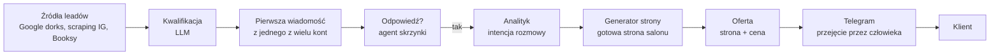

# Instagram AI: system wieloagentowy do pozyskiwania klientów

**Projekt komercyjny. Kod jest prywatny, tutaj opisuję, jak system działa.**
Python · asyncio · Playwright · browser-use · MCP · LLM (Claude, GPT, Gemini) · SQLite · Telegram Bot API · VPS

System sam znajduje salony beauty na Instagramie, pisze do nich, rozpoznaje zainteresowanie, generuje dla każdego zainteresowanego gotową stronę www i wysyła ofertę. Ja wchodzę do rozmowy tylko wtedy, gdy klient jest gotowy do zakupu.

## Wynik

| | |
|---|---|
| Wysłane pierwsze wiadomości | **5 142** |
| Odpowiedzi | **2 671 (52%)** |
| Wysłane oferty z gotową stroną | **ok. 2 600** |
| Klienci | **ok. 30 w 3 miesiące**, bez handlowca |
| Konta Instagram pracujące równolegle | **do 15** |

## Lejek

1. **Leady**: profile firm z Google (dorki), scraping profili Instagram w wybranych miastach i salony z Booksy. LLM odsiewa profile, które nie są firmą albo nie pasują do branży.
2. **Pierwsza wiadomość** idzie z jednego z kont, z wariantem treści dobranym do konta (inne teksty piszą konta kobiece, inne męskie), w seriach rozłożonych na cały dzień.
3. **Agent skrzynki** regularnie przegląda rozmowy, a **analityk** ocenia intencję odpowiedzi: zainteresowanie, pytanie, odmowa, komunikat systemowy Instagrama.
4. Dla zainteresowanych **generator** buduje animowaną stronę salonu z jego zdjęć i danych ([opis generatora](https://github.com/patrykolech/beauty-site-generator)).
5. **Oferta** z linkiem do gotowej strony i ceną zależną od wielkości profilu.
6. **Telegram**: dostaję powiadomienie o zainteresowanym kliencie, odpisuję sam, a potem bot kontynuuje rozmowę zaplanowanymi wiadomościami i przypomnieniami.

## Architektura

- **System wieloagentowy na VPS.** Orkiestrator uruchamia agentów z osobnymi rolami: zwiadowca (kolejka i wysyłka), analityk (ocena odpowiedzi), wykonawca (budowa strony i oferta), agent skrzynki, opiekun rozmów.
- **Asynchroniczna komunikacja przez szynę zdarzeń.** Agenci nie wołają się bezpośrednio, tylko publikują zadania na tematach w bazie (SQLite w trybie WAL). Zadania mają ponawianie, odraczanie i przywracanie po awarii.
- **Własny serwer MCP dla każdego konta.** Każde konto ma osobny profil przeglądarki (przeglądarka antidetect, stałe proxy mobilne), a agenci sterują nim przez narzędzia MCP: otwórz rozmowę, przeczytaj wątek, wyślij wiadomość, sprawdź skrzynkę.
- **Najpierw kod, model tylko awaryjnie.** Odczyt rozmowy i proste akcje robi kod (selektory, kotwica ostatniej zapisanej wiadomości), a agent przeglądarkowy z modelem LLM wkracza dopiero, gdy kod nic nie znajdzie. To obniżyło koszt i liczbę błędów.
- **Łańcuchy modeli z zapasem.** Każda rola ma model główny i zapasowe u innych dostawców. Brak środków u dostawcy (402) nie zjada prób, tylko odracza zadanie do czasu doładowania.
- **Telegram jako centrum sterowania**: powiadomienia, przyciski (ponów, pomiń, wstrzymaj wysyłkę), raporty kosztów i zmiana ustawień w locie bez restartu.

## Bezpieczeństwo kont i jakość

- **Plan dnia dla każdego konta**: noc, jedna dłuższa i kilka krótkich przerw z losowym przesunięciem, wysyłka seriami, limit wiadomości na godzinę i na dzień, osobne odstępy między ofertami.
- **Wykrywanie blokad**: „Failed to send”, zawieszenie konta czy wymóg weryfikacji automatycznie wstrzymują konto, a jego leady przechodzą na inne konta.
- **Kontrola, czy otwarta jest właściwa rozmowa**, zanim cokolwiek zostanie zapisane albo wysłane.
- **Testy A/B ofert**: treść, cena, wariant ze zdjęciem i bez, z podziałem na grupy od ustalonej daty.
- **Pomiar kosztów** każdego kroku agenta i każdej strony, porównanie modeli na tych samych zadaniach.

## Moja rola

Całość zaprojektowałem i zbudowałem sam, z pomocą asystentów AI (Claude Code): lejek, architekturę agentów, integracje, generator stron, wdrożenie na serwer i codzienną obsługę sprzedaży.

---

**Autor:** Patryk Olech, AI Automation & GTM Engineer · [inne projekty](https://github.com/patrykolech)
