# Animated website generator from an Instagram profile (Agentic AI)

> This folder is part of the [Instagram sales system](../README.md): it contains the website generator code, while the whole system is described in the main README.

**One command: a beauty salon's Instagram handle → a finished, animated business website.**
Python · LLM agents (Claude, GPT, Gemini) · vision models · Playwright · OpenCV · GSAP + ScrollTrigger + Lenis

The generator is part of my system for selling websites to beauty salons. When a salon replied to the first message, the generator immediately built a **demo website of their business** from their Instagram profile: a sample animated website showing what I can build. The next message was an offer with a link to that demo, before the salon paid anything. The final website was built after the purchase. The client saw the result straight away, which is why the demo was the strongest argument to buy. The whole funnel brought **~30 clients in 2 months**.

## Live examples

| Version | Website |
|---|---|
| Current: "Moment in the mirror" (a compact opens on scroll, the mirror shows a photo from the profile) | [examplewebsite.pl/zaczarowanerzesypoznan](https://examplewebsite.pl/zaczarowanerzesypoznan/) |
| Earlier template (magazine layout) | [examplewebsite.pl/agath_concept](https://examplewebsite.pl/agath_concept/) |

Best viewed on a phone, because that is where clients opened the link from the message.

## How it works

```mermaid
flowchart LR
    A[IG profile data\nbio, posts, photos] --> B[Verifier\nname, city, service]
    B --> C[Logo\nrecreated or generated]
    C --> D[Photo selection\nvision model]
    D --> E[Art director\npalette from 11 families]
    E --> F[Copywriter\nAbout, FAQ, contact]
    F --> G[Website build\nHTML + GSAP]
    G --> H[QA on phone\nscreenshots]
    H -->|ready| I[Publish\ndomain + SSL]
    H -->|needs fixes| G
```



1. **Verifier** determines the business name (with Polish characters), city, voice ("I / we") and service type (lashes, brows, PMU, nails, skincare).
2. **Logo** is recreated from the avatar or highlight covers, or generated when there is none ([`generator_logo.py`](generator_logo.py)).
3. **Photo selection**: a vision model scores the profile photos on thumbnail sheets and picks the best shots for the hero, gallery and mirror ([`dobierz_zdjecie.py`](dobierz_zdjecie.py)).
4. **Art director** picks one of 11 colour families based on highlight covers and posts ([`paleta_beauty.py`](paleta_beauty.py)).
5. **Copywriter** writes the About section, the contact text and the footer, and polishes the FAQ.
6. **Build**: compact layers with a lid colour matched to the client ([`puderniczka.py`](puderniczka.py)), the hero and the full page from the template ([`szablon/`](szablon/), [`zbuduj_strone.py`](zbuduj_strone.py)).
7. **QA**: Playwright takes screenshots in a phone viewport, an agent reviews them and returns "ready" or a list of issues, which are checked a second time.

Everything is run by [`generuj.py`](generuj.py); the agents live in [`agenci.py`](agenci.py).

**Two modes:** the generator runs automatically inside the [Instagram sales system](../README.md) (a demo is built when a salon replies to the first message) or on its own from a dashboard: enter a salon's handle and get a finished website, e.g. for a conversation with a client outside the campaign.

## Key decisions

- **An agent cannot add facts that are not in the data.** Code checks every model answer: the name, city or service only pass if the profile data confirms them, so the website never invents an address or a service the salon does not offer.
- **Fallback models.** Every role has a chain of models (e.g. Claude Sonnet, then GPT on error). A provider outage or running out of credits does not stop the generator.
- **Response cache.** Agent results are saved, so a second run for the same client costs almost nothing.
- **AI cost ~0.10-0.15 PLN per demo website**, depending on the chosen template and the models assigned to the agents, tracked live from API usage counters.
- **A generator, not manual assembly.** The template works for the whole beauty industry (lashes, brows, PMU, nails, make-up), and scenes and photos adapt to the service type.

## Animation and performance

- GSAP + ScrollTrigger + SplitText + Lenis ([`assets/js/`](assets/js/)): the compact opens on scroll and the mirror grows into a full-size photo.
- The page also works without JavaScript, and animations respect `prefers-reduced-motion`.
- A fix for Instagram's in-app browser (viewport height changing when the toolbars hide).
- Tests in [`testy/`](testy/): frame-by-frame animation smoothness, accessibility, layout, LCP, no-JS version.

## Structure

```
generuj.py            the whole process in one command
agenci.py             verifier, art director, copywriter, QA (API calls with answer validation)
dobierz_zdjecie.py    photo selection with a vision model
generator_logo.py     logo recreation or generation
puderniczka.py        hero graphic layers matched to the client
zbuduj_hero.py        website hero
zbuduj_strone.py      the full page from the template
szablon/              section HTML (services, gallery, reviews, FAQ, contact...)
assets/               CSS, JS, fonts (OFL)
baza/, obrazy/        shared compact layers (AI-generated graphics)
testy/                animation, accessibility and performance tests
```

## Running it

```bash
pip install pillow numpy scipy opencv-python-headless playwright
playwright install chromium

export BYTECATCODE_CLAUDE_KEY=...    # keys for the model API gateways
export BYTECATCODE_OPENAI_KEY=...
export BSF_DATA=/path/to/data        # profile data: <handle>/profile.json + photos

python generuj.py <handle>
```

Profile data comes from my Instagram scraper and is not part of the repository.

## Notes

- The repository contains no client photos, logos or data. Names in the examples are changed.
- Fonts under the SIL OFL licence; GSAP and Lenis used under their licences.
- File and function names in the code are in Polish.

---

**Author:** Patryk Olech, AI Automation & GTM Engineer · [more projects](https://github.com/patrykolech)
